<a href="#selected-work">Selected work</a> &nbsp;·&nbsp; <a href="#open-source-and-writing">Open source</a> &nbsp;·&nbsp; <a href="#skills-and-tools">Skills</a> &nbsp;·&nbsp; <a href="https://www.linkedin.com/in/lokesh-rana-310988126">LinkedIn ↗</a>

**Product engineer building AI-agent systems** · Co-developed an AI agent platform's runtime (over 5,000 AI workflow runs a day) · React/TypeScript, Node.js, Python

Product engineer with about 7 years of experience building AI-agent systems. Co-developed the runtime of an AI agent platform for US health-tech and ed-tech customers (over 5,000 AI workflow runs a day) and built a multi-agent Claude Code pipeline that cut learning-game creation from 2 days to 1 hour. I scope, ship and demo with clients' teams; React/TypeScript, Node.js, Python.

IIT Guwahati alumnus (BTech, Bioscience and Bioengineering); Google Summer of Code 2021 developer. Based in Sikar, Rajasthan, India; open to remote roles or relocating within India.

## Selected work

 

01 / INCUBYTE · SOFTWARE CRAFTSPERSON · APRIL-OCTOBER 2026

### 🔀 Rolai — an AI agent platform

`AI agents` · `Job-queue runtime` · `Node.js` · `PostgreSQL` · `Claude Code`

On an Incubyte team inside a client's team, building Rolai, its AI agent platform for US health-tech and ed-tech customers.

- Co-developed a fault-tolerant job-queue runtime (Node.js, TypeScript, PostgreSQL) for over 5,000 customer AI workflow runs a day, so long-running workflows finish instead of hanging.
- Enabled end users to run AI workflows and datasets 100x larger by cutting runtime memory 95% (blob storage) and making PostgreSQL database writes 80% smaller.
- Reduced code-review time and back-and-forth on AI-generated code by building Claude Code PR-review and PR-description skills from past reviewer comments, adopted by teammates for self-review.
- Owned client-facing delivery: scoped features with the client's team, demoed releases to their leadership, and resolved end-user issues after launch.

 

02 / OPEN SOURCE · AUTHOR

### 🛠️ [shipyard](https://github.com/lokeshrana9999/shipyard) — agent skills for coding agents

`Agent skills` · `Claude Code` · `Codex`

Wrote shipyard, open-source agent skills that take a change from question to a tested, live-checked, reviewed pull request in Claude Code, Codex and other agents.

 

03 / INFYBYTES · SOFTWARE DEVELOPER · JULY 2023-DECEMBER 2025

### 📐 [MathAI](https://mathai.ai/) — learning games

`Multi-agent workflows` · `PixiJS` · `React` · `Razorpay`

MathAI, a learning-games app: over 20,000 users, over 2,000 concurrent users at daily peak.

- Architected the Figma-to-Web game engine (PixiJS, React, TypeScript) behind 1,000+ published learning games, cutting a single puzzle type's development from 2 weeks to 2 days.
- Cut learning-game creation from 2 days to 1 hour with a multi-agent LLM pipeline (Claude Code) that turned a lesson idea into a published game.
- Shipped recurring subscription billing (Razorpay UPI autopay, Node.js, GraphQL) so MathAI subscriptions renewed automatically, with payment retries, free trials and multi-currency pricing.
- Automated JavaScript game logic for over 500 published games with an LLM code-generation pipeline built in Langflow.

 

04 / UPLARA AND SUNMALL · SOFTWARE DEVELOPER · JUNE 2021-MAY 2023

### 🛍️ E-commerce extensions

`Shopify` · `FastAPI` · `GCP`

- Built and shipped multi-platform e-commerce extensions (Shopify, WooCommerce, BigCommerce) used by over 100 stores serving thousands of customers.
- Cut deploy time 70% with parallel GCP Cloud Functions deploys in CI/CD, then a further 60% by moving the backend to FastAPI on a VM.

 

EARLIER

- **Freelance, Web Developer (November 2019-June 2021):** Shipped full-stack products from proof of concept to production as sole developer for startups and an L&D consultancy, including a real-time learning platform.
- **LensHood, Frontend Lead (April-November 2019).**

## Open source and writing

<table>
<tr><td width="50%" valign="top"><h3><a href="https://github.com/lokeshrana9999/shipyard">🛠️ shipyard</a></h3>
Open-source agent skills for Claude Code, Codex and other coding agents.
</td><td width="50%" valign="top"><h3><a href="https://medium.com/@lokeshrana_17800/what-fiction-writers-know-about-prompting-that-engineers-dont-0b6a2eac6628">✍️ What fiction writers know about prompting that engineers don't</a></h3>
An essay on prompting, on Medium.
</td></tr>
<tr><td width="50%" valign="top"><h3><a href="https://www.shraddhapailab.com/our-team">🧬 Google Summer of Code 2021 — Shraddha Pai Lab</a></h3>
Built a React and Cytoscape.js viewer that renders hierarchical gene-annotation networks in under a second.
</td><td width="50%" valign="top"><h3><a href="https://github.com/elastic/eui/pull/3174">🔧 Elastic UI</a></h3>
A merged fix for mobile-navigation scrolling in the EUI component library.
</td></tr>
</table>

## Skills and tools

| Area | Technologies |
| --- | --- |
| **🤖 AI and agents** | AI agents, multi-agent workflows, Claude Code, Codex, MCP servers, OpenAI APIs, Langflow, prompt engineering, RAG |
| **🗄️ Backend and data** | Node.js, TypeScript, Express, Python, FastAPI, PostgreSQL, MongoDB, GraphQL, Hasura, Prisma, REST APIs, async job queues |
| **🖥️ Frontend** | React, Next.js, JavaScript, PixiJS, WebGL, D3.js, Cytoscape.js |
| **🧰 Infrastructure and payments** | GCP, Google Cloud Functions, CI/CD, Docker, blob storage, Razorpay subscription billing |
